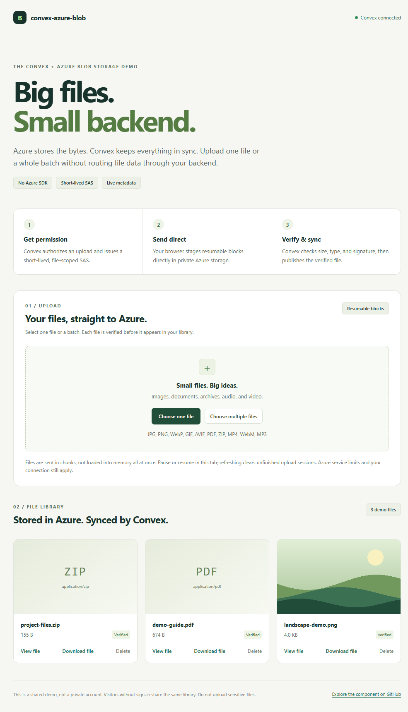
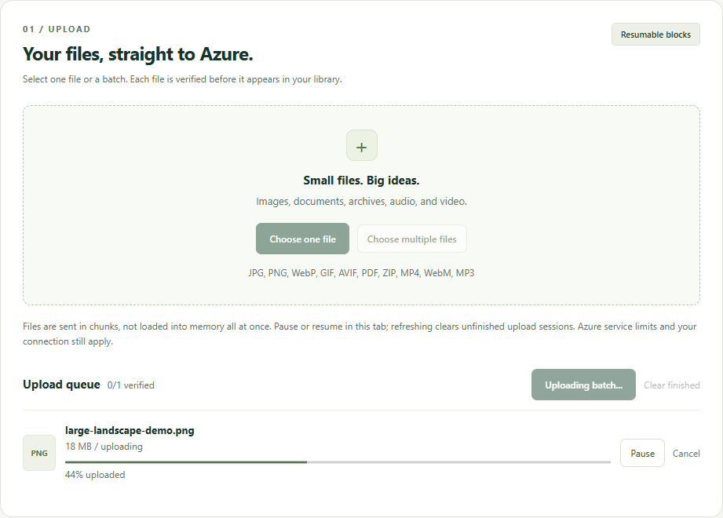
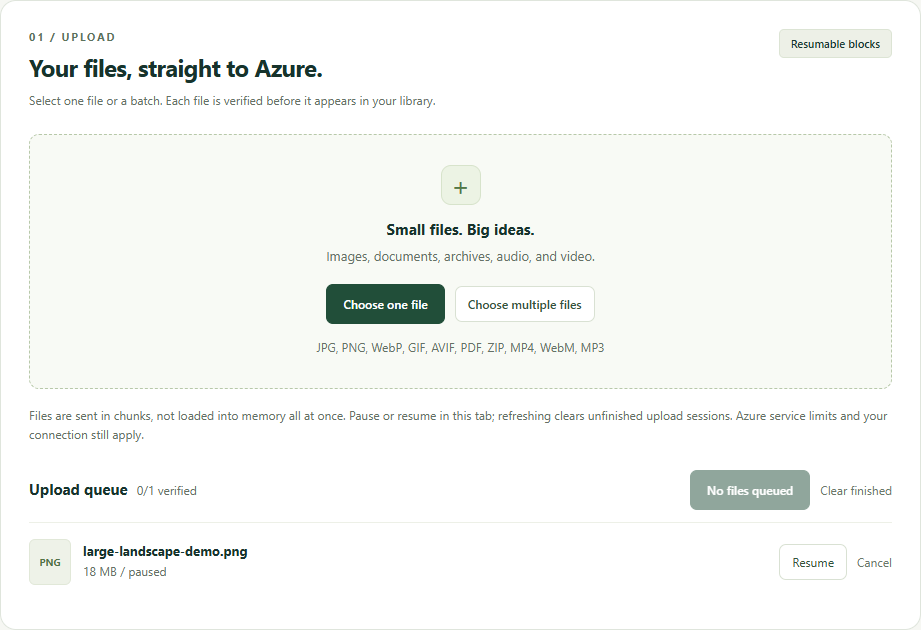
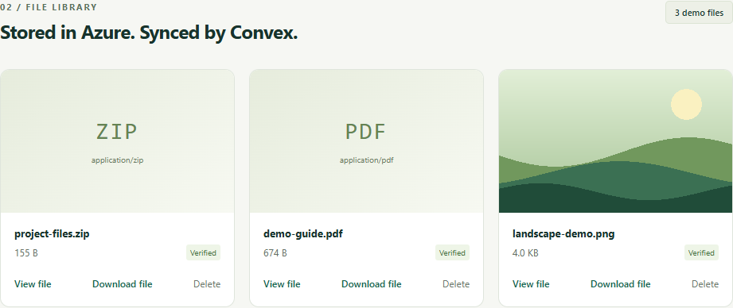

# Example app walkthrough

The example demonstrates direct browser uploads to Azure Blob Storage, with
authorization, upload verification, and live file metadata in Convex.

Screenshots use original demo files from a live Azure test. Unrelated files in
the shared demo library are excluded from the screenshots; no credentials or
signed URLs are shown.

## 1. Choose one file or a batch

Select **Choose one file** or **Choose multiple files**. Review the queue, then
select **Upload file** or **Upload N files**.

The example accepts JPEG, PNG, WebP, GIF, AVIF, PDF, ZIP, MP4, WebM, and MP3.
Files upload sequentially within a batch, with up to three block requests per
file. A failed file does not hide the results of other files.

## 2. Pause and resume

**Pause** stops active requests while keeping the file and successful block IDs
in the current tab. **Resume** renews the same upload ticket and sends only
unfinished blocks.

Resume also works after a recoverable transfer failure. **Cancel** discards the
local session. Refreshing or leaving the page clears unfinished sessions;
resuming across page reloads is not supported.

## 3. View, download, or delete a verified file

Convex checks the staged sizes before committing, then checks the file's content
type and leading-byte signature. Once confirmed, the file appears in the
reactive library.

- **View file** opens a signed read URL in a new tab. Supported images, PDFs,
  audio, and video use the browser's viewer. ZIP files and unsupported formats
  may download instead.
- **Download file** uses an attachment URL with the original file name.
- **Delete** removes the app's reference and schedules Azure cleanup.

Confirmed block uploads are served from immutable snapshots so a reused staging
SAS cannot change the content that was verified.

## Running and troubleshooting

Follow the [example setup](../README.md#example-app) and the
[Entra setup guide](../README.md#microsoft-entra-user-delegation-sas).

- Keep `npm run dev` and `npm run dev:frontend` running in separate terminals.
- If the connection indicator is disconnected, check the backend process and
  `VITE_CONVEX_URL` before investigating Azure.
- Browser uploads need a **Blob service CORS** rule for the exact frontend
  origin. For `http://localhost:5173`, allow `PUT, GET, HEAD, OPTIONS` and the
  `content-type` and `x-ms-version` headers. See the
  [complete CORS rule](../README.md#an-azure-storage-account), including exposed
  headers, and select **Save** in the portal.
- Signature checks are not malware scanning. Apply authentication, quotas, and
  application-specific size ceilings before using the demo in production.

The example deliberately uses a shared identity when visitors are not signed in.
Do not upload sensitive files.
